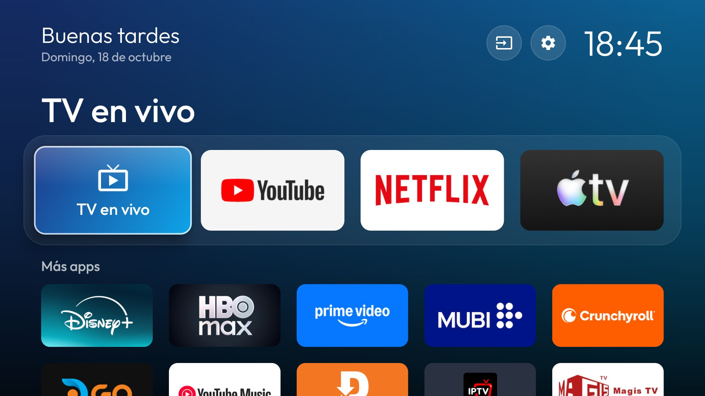

# tv-homemade

A homemade launcher for a low-RAM Android TV, plus the scripts to debloat it and undo everything.



Built for my mom's JVC TV (1.5 GB RAM), where the stock launcher alone used about 190 MB and the
TV felt slow. tv-homemade uses 35-65 MB and only shows what she watches: live TV, a few streaming
apps and the HDMI inputs.

Inspired by [tv-vibehack](https://github.com/Gathin23/tv-vibehack), which does the same for other TVs.

## What you get

- **Four favorites** in a dock, everything else in a grid below. Long-press any tile and move it
  with the arrow keys; moving between the first grid row and the dock swaps it in or out of the
  favorites. OK saves the order on the TV.
- **TV en vivo** always opens the tuner, not whichever HDMI port was used last.
- **Inputs menu** for HDMI 1-4 and AV, marking the ones the TV reports as connected.
- A blurred backdrop taken from the focused app, a clock and the date, all in Spanish.
- **Optional background photo** that stays on the TV, never in the repo (see below).
- A **clock screensaver** that drifts around to avoid burn-in.

Written in Kotlin with Jetpack Compose, minified with R8. No network access, no analytics.

## How it works

Android TVs accept `adb` over the network once network debugging is on. Everything here goes
through it:

1. `tools\install.ps1` builds the launcher, installs it and sets it as the default launcher and screensaver.
2. `tools\disable.ps1` backs up the package list and settings, then disables the apps in a
   [device list](devices/) with `pm disable-user`. Nothing is uninstalled.
3. `tools\restore.ps1` re-enables the same list and brings the stock launcher back.

The scripts are PowerShell because this was done from Windows.

## Quick start

1. On the TV: **Settings > Device Preferences > About**, press OK on **Build** seven times. Then in
   **Developer options** turn on **USB debugging** (and **Network debugging** if your TV lists it
   separately).
2. Find the TV's IP in **Settings > Network**.
3. On the PC, install adb (`winget install Google.PlatformTools`), JDK 17 and the Android SDK
   (`ANDROID_HOME`), then:

```powershell
$env:TV_HOST = "192.168.1.50:5555"   # or pass -TvHost to each script
.\tools\install.ps1                  # accept the debugging prompt on the TV
.\tools\disable.ps1 -DryRun
.\tools\disable.ps1
```

Every script supports `-DryRun` and prints exactly what it would run.

## Background photo

The photo is not part of the app. It is copied to the launcher's own storage on the TV:

```powershell
.\tools\set-photo.ps1 -Path C:\Users\me\Pictures\family.jpg
.\tools\set-photo.ps1 -Remove
```

It is drawn faded, about 350x400 dp, to the right of the title, so a portrait crop with faces in the
upper half works best. Uninstalling the launcher deletes it.

## Configuration

Defaults live in [`LauncherConfig.kt`](launcher/app/src/main/java/dev/tvhomemade/launcher/LauncherConfig.kt):
the initial four favorites, which apps start the grid, apps to hide and the Live TV package. After
that, favorites and order are edited on the TV.

## Undo

```powershell
.\tools\restore.ps1              # re-enable apps, stock launcher, default settings
.\tools\restore.ps1 -RemoveLauncher
```

## Adding a TV

Copy `devices/jvc-changhong-ai-pont/` and write your own `debloat.txt`. Only list packages you have
checked; the backup in `backup\<timestamp>\` (git-ignored) shows what is installed. Disabling the
wrong system package can break setup screens or inputs, and the safe list differs per brand.

## License

MIT, see [LICENSE](LICENSE). The bundled [Outfit](https://fonts.google.com/specimen/Outfit) typeface
is under the SIL Open Font License, see [`launcher/FONT-LICENSE-OFL.txt`](launcher/FONT-LICENSE-OFL.txt).
Icons are from Material Symbols (Apache 2.0).
